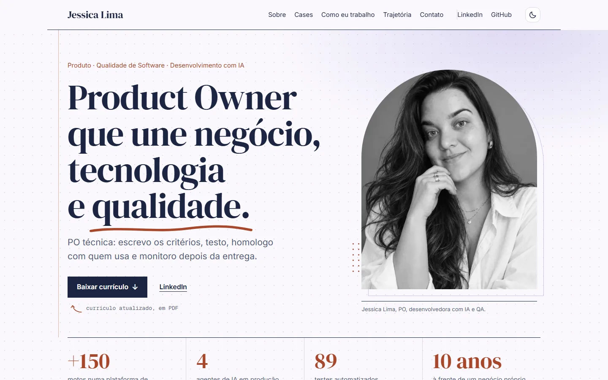
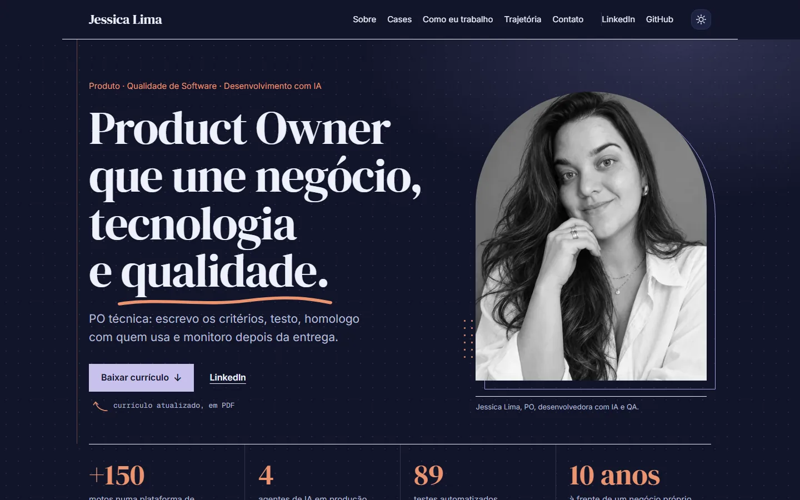
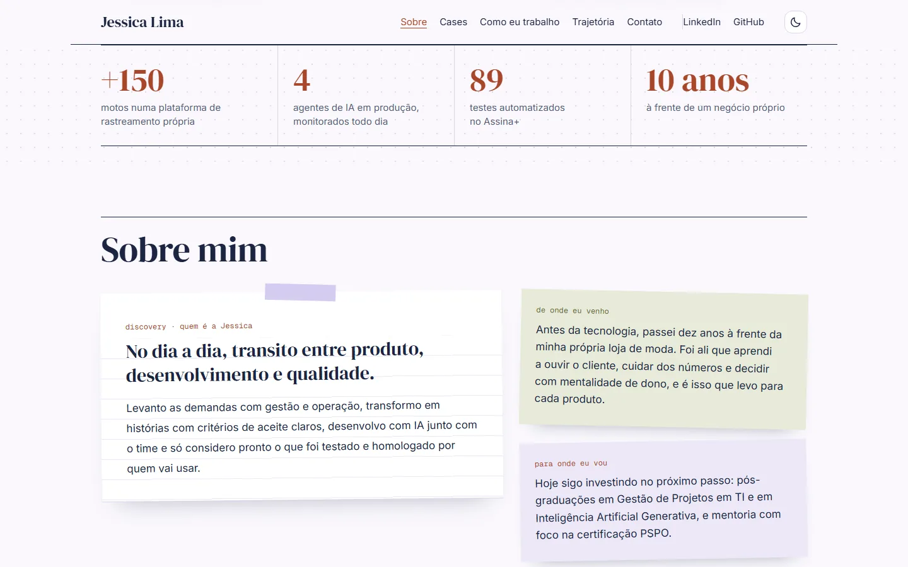
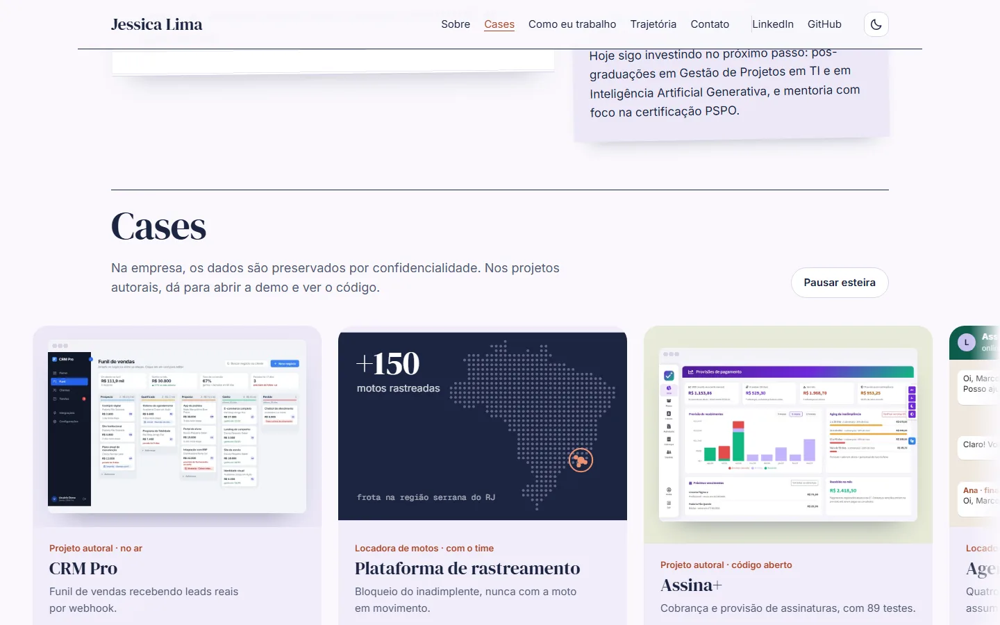
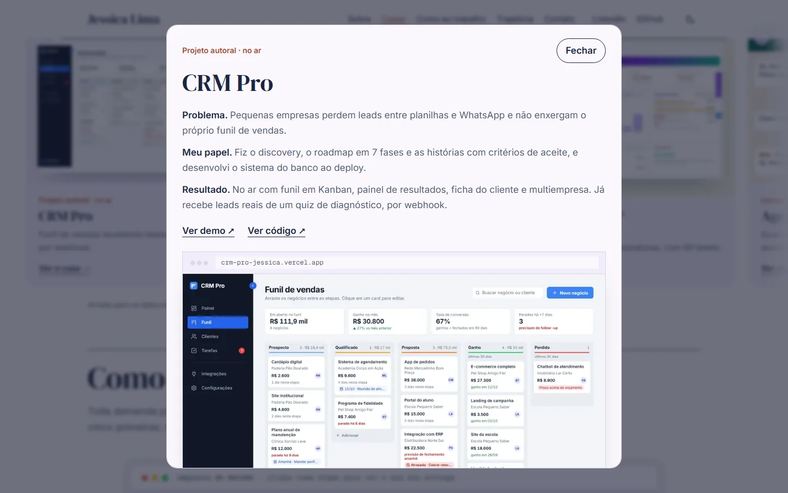
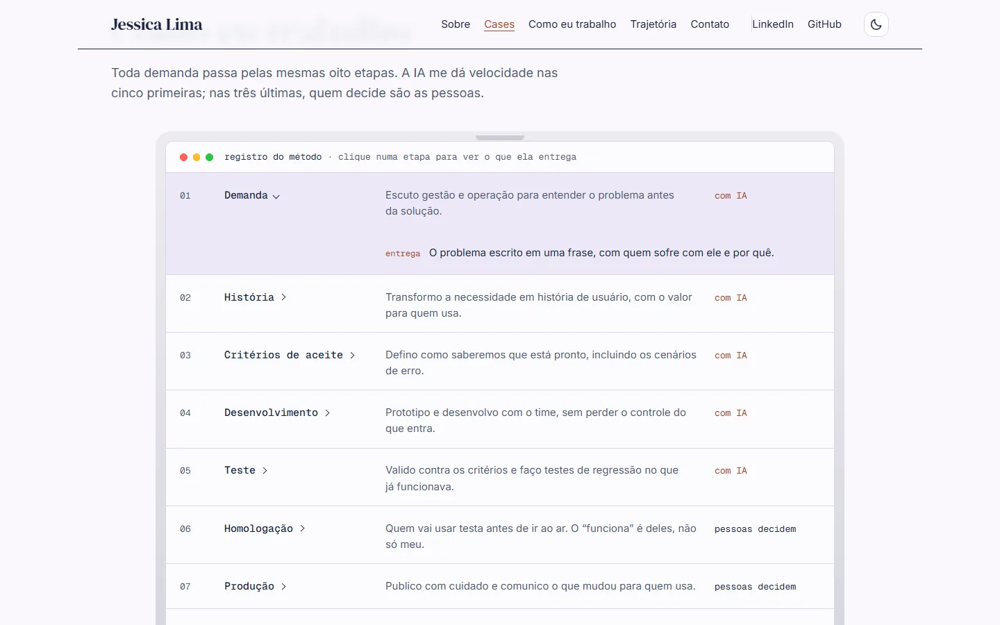
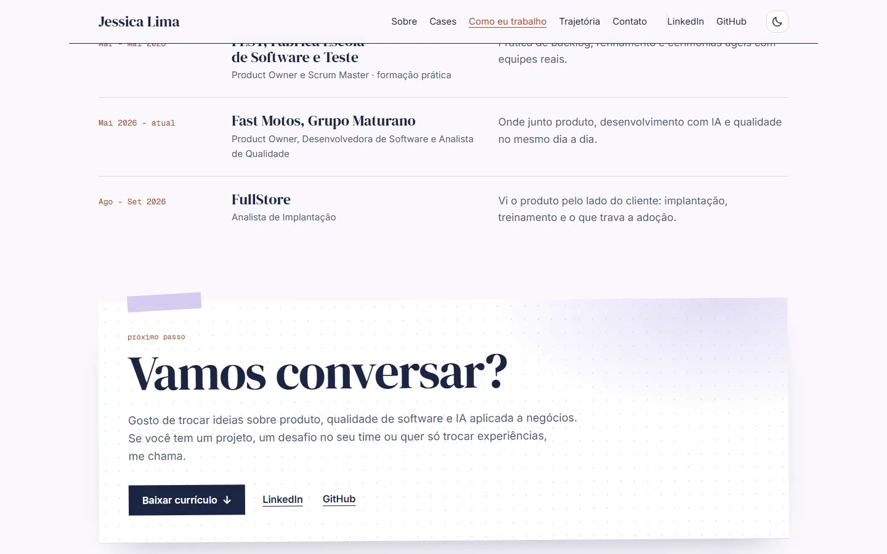
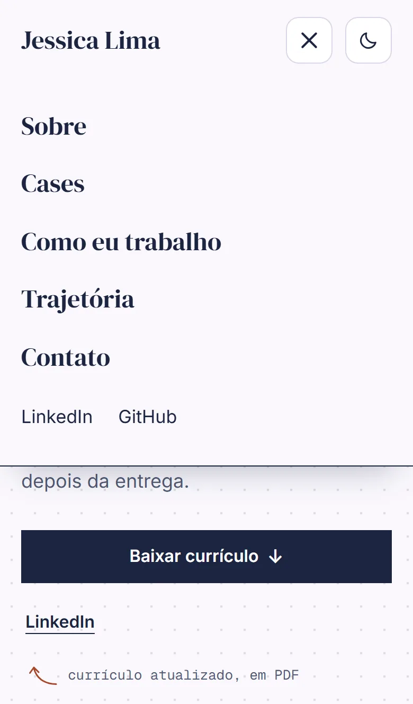
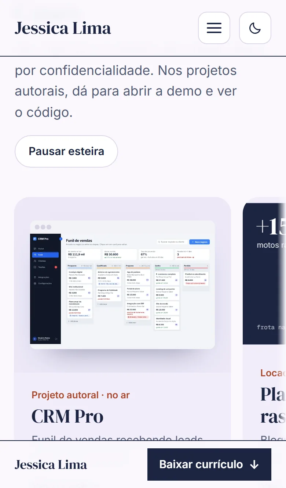

# Portfólio · Jessica Lima

> **Product Owner que une negócio, tecnologia e qualidade.**
> PO técnica: escrevo os critérios, testo, homologo com quem usa e monitoro depois da entrega.

Este repositório é o meu portfólio e também um case: ele foi construído como um produto, com PRD, user stories, critérios de aceite e qualidade verificada a cada mudança.

**No ar:** [jessica-lima.vercel.app](https://jessica-lima.vercel.app)



## Telas

| Modo escuro | Sobre mim, como uma folha de discovery |
|---|---|
|  |  |

| Esteira de cases (anda sozinha e dá para arrastar) | Case aberto, com as telas reais |
|---|---|
|  |  |

| Como eu trabalho, num MacBook | Fechamento, como uma página do caderno |
|---|---|
|  |  |

| Celular | Menu no celular | Cases no celular |
|---|---|---|
|  |  |  |

### Decisões de design

- **Paleta lavanda luminosa:** azul-marinho no texto, terracota nos destaques, lavanda e verde-oliva nos detalhes, com modo claro e escuro que segue o sistema.
- **Estética de caderno:** papel pontilhado, fita adesiva e post-its no topo, no Sobre mim e no fechamento, para remeter ao discovery.
- **Menos texto na tela:** os cases mostram uma frase na esteira e abrem os detalhes numa janela.
- **Confidencialidade:** os cases da empresa usam ilustrações próprias, sem dados reais. Os projetos autorais mostram as telas, com dados de demonstração.
- **Movimento com controle:** a esteira para no mouse, no foco, no toque e no botão de pausa, e fica parada para quem pede menos movimento.

## Documentos de produto

- [Mini-PRD](docs/PRD.md): problema, público, métricas de sucesso, escopo e riscos
- [User stories](docs/user-stories.md): histórias do MVP com critérios de aceite em Gherkin e ordem de entrega

## Qualidade

Cada mudança passa pelo CI antes de ir ao ar:

| Verificação | Ferramenta | Critério |
|---|---|---|
| Lint e tipos | oxlint, TypeScript | Sem erros |
| Testes de componentes | Vitest, Testing Library | Todos passando |
| Fluxos no navegador (desktop e celular) | Playwright | Todos passando |
| Acessibilidade | axe-core | Zero violações WCAG 2.1 AA |
| Performance, acessibilidade, boas práticas e SEO | Lighthouse CI | Nota ≥ 90 em todas |

## Rodando localmente

Requer Node 24.

```bash
npm install
npm run dev
```

| Comando | O que faz |
|---|---|
| `npm run dev` | Abre o site em modo desenvolvimento |
| `npm test` | Roda os testes de componentes |
| `npm run test:e2e` | Roda os testes no navegador, incluindo acessibilidade |
| `npm run lint` / `npm run typecheck` | Verifica estilo e tipos |
| `npm run build` | Gera a versão de produção em `dist/` |

## Stack

React 19 · TypeScript · Vite · Vitest · Playwright · axe-core · Lighthouse CI · GitHub Actions · Vercel

## Medição de conversão

Os cliques em "Baixar currículo", LinkedIn, GitHub e nos links dos cases geram eventos (`src/lib/analytics.ts`).
Para registrar, crie o site no [Plausible](https://plausible.io) e defina a variável `PLAUSIBLE_DOMAIN` no build
(na Vercel: *Settings → Environment Variables*). Sem ela, nenhum script de terceiros é carregado.
